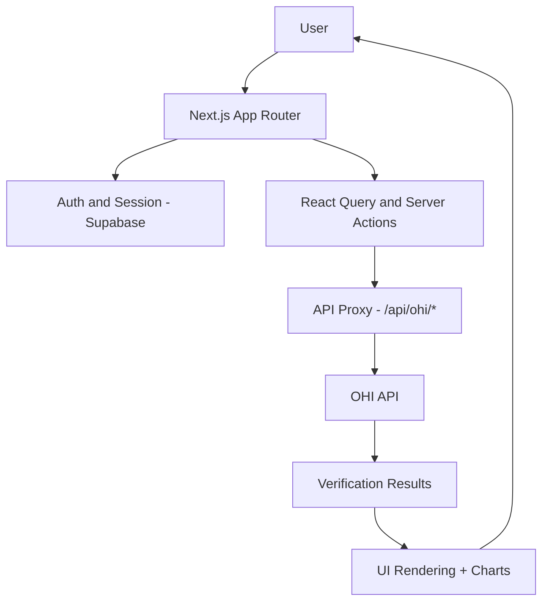
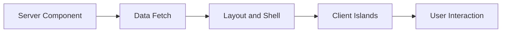

# Open Hallucination Index Frontend

Next.js 16 App Router application for the Open Hallucination Index. This UI focuses on claim verification workflows, evidence visualization, and actionable reporting.

---

## Highlights

- **App Router-first**: Server Components by default, client where needed
- **Auth & Sessions**: Supabase + server-side utilities
- **Data layer**: React Query + Server Actions
- **UI system**: Tailwind v4 + shadcn/ui patterns
- **Full TypeScript**: Schema-driven data + strict types

---

## Tech stack

- **Framework**: Next.js 16.1.2 (App Router)
- **Language**: TypeScript 5.9.3
- **UI Library**: React 19.2.3
- **Styling**: Tailwind CSS 4.1.18
- **UI Components**: shadcn/ui (latest)
- **Authentication**: Supabase (@supabase/supabase-js 2.90.1)
- **Database**: Postgres via Drizzle ORM 0.45.1
- **Data Fetching**: TanStack React Query 5.90.17
- **Validation**: Zod 4.3.5
- **Forms**: React Hook Form 7.71.1
- **Testing**: Vitest 4.0.17
- **Icons**: lucide-react 0.562.0
- **Toasts**: sonner 2.0.7
- **Theme**: next-themes 0.4.6
- **Code Quality**: ESLint, Prettier

---

## End-to-end flow



### Page composition model



---

## Getting started

### Prerequisites

- Node.js 26 or higher
- npm or yarn
- A Supabase account and project

### Installation

1. Clone the repository:
```bash
git clone https://github.com/shiftbloom-studio/open-hallucination-index.git
cd open-hallucination-index
```

2. Install dependencies:
```bash
npm install
```

3. Set up environment variables (create `.env.local`):
```
NEXT_PUBLIC_SUPABASE_URL=your-supabase-url
NEXT_PUBLIC_SUPABASE_ANON_KEY=your-supabase-anon-key
NEXT_PUBLIC_APP_URL=http://localhost:3000

# Backend proxy (server-only)
DEFAULT_API_URL=http://localhost:8080
DEFAULT_API_KEY=your-api-key

# Database
DATABASE_URL=your-database-url

# Stripe (optional)
STRIPE_SECRET_KEY=your-stripe-secret-key
STRIPE_WEBHOOK_SECRET=your-stripe-webhook-secret

# Supabase (server-only, optional)
SUPABASE_SERVICE_ROLE_KEY=your-service-role-key
```

4. Generate and push database schema:
```bash
npm run db:generate
npm run db:push
```

5. Run the development server:
```bash
npm run dev
```

Open http://localhost:3000 in your browser to see the application.

---

## Project structure

```
src/
├── app/                    # Next.js App Router pages
│   ├── auth/              # Authentication pages (login, signup)
│   ├── dashboard/         # Dashboard page
│   ├── api/               # API routes
│   ├── layout.tsx         # Root layout
│   ├── page.tsx           # Home page
│   └── providers.tsx      # Client providers (React Query, Theme)
├── components/
│   └── ui/                # shadcn/ui components
├── lib/
│   ├── db/                # Database schema and client
│   ├── supabase/          # Supabase client utilities
│   └── utils.ts           # Utility functions
├── hooks/                 # Custom React hooks
└── test/                  # Test setup
```

---

## API proxy

The frontend ships with a server-side proxy route at `/api/ohi/*` that forwards
requests to `DEFAULT_API_URL` and injects `DEFAULT_API_KEY` as `X-API-KEY`.

Tip: Use the proxy to avoid CORS and keep API keys server-only.

---

## Features

- 🔐 **Authentication**: Supabase-based auth with login/signup
- 📊 **Dashboard**: Verification history and detailed drilldowns
- 🧾 **Traceability**: Knowledge-track visualization ready
- 🎨 **Dark Mode**: Theme switching with next-themes
- 📱 **Responsive**: Mobile-first responsive design
- 🔍 **Type Safe**: Full TypeScript support
- ✅ **Testing**: Vitest for unit and integration tests
- 🎯 **Form Validation**: React Hook Form with Zod schemas

---

## Scripts

- `npm run dev` - Start development server
- `npm run build` - Build for production
- `npm run start` - Start production server
- `npm run lint` - Run ESLint
- `npm run test` - Run tests with Vitest (watch mode)
- `npm run test:run` - Run tests once
- `npm run test:ui` - Run tests with UI
- `npm run db:generate` - Generate Drizzle migrations
- `npm run db:migrate` - Run Drizzle migrations
- `npm run db:push` - Push schema to database
- `npm run db:studio` - Open Drizzle Studio

---

## UX and performance tips

- Prefer Server Components for data-heavy views
- Use client components only where interactivity is required
- Use React Query to cache API responses and avoid duplicate calls
- If charts are slow, defer rendering until data is stable

---

## Contributing

Contributions are welcome. Please submit a pull request with a clear summary and screenshots where relevant.

---

## License

AGPL-3.0-or-later, see the [LICENSE](../../LICENSE) in the repository root.

## Legal pages

The Impressum, privacy and terms pages read the operator's name and address
from `NEXT_PUBLIC_OPERATOR_*` at build time (`src/lib/operator.ts`). Keep the
real values in the deploy environment; `.env.example` lists the variables.
